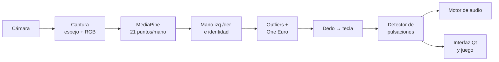

# 🎹 HandPiano

**Un piano virtual que se toca con las manos delante de la cámara del ordenador.**

HandPiano sigue tus manos con la webcam, dibuja un piano sobre el vídeo y hace sonar la tecla que hay debajo de cada dedo cuando ese dedo baja. Suena con muestras de pianos reales (Grand, Upright y Electric) y trae un **Piano Libre** y un **Juego Rítmico** de 4 carriles con 4 canciones. Todo se procesa **en tu ordenador**: no se guarda ni se envía ninguna imagen.


-lightgrey?logo=apple)

-41CD52?logo=qt&logoColor=white)


---

## Índice

1. [Qué hace y en qué estado está](#qué-hace-y-en-qué-estado-está)
2. [Instalación](#instalación)
3. [Inicio rápido](#inicio-rápido)
4. [Cómo colocarte y cómo tocar](#cómo-colocarte-y-cómo-tocar)
5. [Modos: Piano Libre y Juego Rítmico](#modos-piano-libre-y-juego-rítmico)
6. [Controles de teclado](#controles-de-teclado)
7. [Todas las opciones de la línea de comandos](#todas-las-opciones-de-la-línea-de-comandos)
8. [Cómo funciona por dentro](#cómo-funciona-por-dentro)
9. [Qué se ha medido](#qué-se-ha-medido)
10. [Herramientas de medición y grabación](#herramientas-de-medición-y-grabación)
11. [Tests](#tests)
12. [Estructura del proyecto](#estructura-del-proyecto)
13. [Privacidad](#privacidad)
14. [Limitaciones conocidas](#limitaciones-conocidas)
15. [Créditos y licencias](#créditos-y-licencias)

---

## Qué hace y en qué estado está

**Funciona:**

- **Seguimiento de las dos manos** con MediaPipe Hand Landmarker: 21 puntos por mano, 8 dedos de juego (índice, medio, anular y meñique de cada mano), con identidad izquierda/derecha validada.
- **Piano en pantalla**: 2 octavas (C4–B5) dibujadas en una posición fija del vídeo. No hace falta calibrar nada. También existe un piano "sobre la mesa", calibrado con 4 esquinas (`--piano-mesa`).
- **Detección de pulsaciones** por dedo: una máquina de estados detecta cuándo baja un dedo y suena la tecla que tiene debajo.
- **Guía de colocación**: una barra en la parte de abajo del vídeo se pone **verde** cuando las manos están bien colocadas y, si no, dice qué corregir ("Sube la mano derecha…").
- **Medidor por dedo**: junto a cada punta de dedo, una barrita muestra cuánto ha bajado ese dedo; se pone verde cuando cuenta como pulsación.
- **Sonido real**: tres pianos muestreados, motor polifónico propio, cambio de instrumento al vuelo y volumen.
- **Juego Rítmico 4K** con 4 canciones de dominio público, puntuación, combo y precisión.
- **Teclado y ratón como alternativa**: el piano siempre se puede tocar también con el teclado del ordenador.

**Lo que hay que saber (medido, no supuesto):** con la webcam del portátil, la cámara ve las manos casi todo el tiempo (97–100 %), pero **no siempre distingue qué dedo ha tocado**. Cuando un dedo baja, en la imagen se mueve poco, y los vecinos se mueven casi lo mismo. En pruebas guiadas, el detector reconoce entre el 7 y el 22 % de los toques individuales, según el ajuste. Tocando libremente sí suena y responde, pero no como un piano real. Los números están en [Qué se ha medido](#qué-se-ha-medido).

---

## Instalación

Requisitos: macOS en Apple Silicon (la plataforma probada), Python 3.11–3.13 y una cámara.

```bash
git clone https://github.com/kcitas/hand-piann0.git
cd hand-piann0

python3.13 -m venv .venv
source .venv/bin/activate
python -m pip install -e ".[dev]"

# 1) Modelo de detección de manos (~7.8 MB; se verifica su SHA-256)
python scripts/download_model.py

# 2) Sonidos de los tres pianos (~110 MB en sounds/; se verifica la afinación de cada muestra)
python scripts/download_sounds.py
```

Estas dos descargas son las únicas veces que la app necesita Internet. El modelo y los sonidos no se suben al repositorio.

> - `mediapipe` ya instala su propio OpenCV. **No** instales `opencv-python` aparte: los dos aportan `cv2` y chocan.
> - Se usa `PySide6-Essentials`, no el paquete `PySide6` completo, que ocupa ~500 MB más sin aportar nada a la app.
> - **Permiso de cámara en macOS:** la primera vez, macOS pide permiso para la aplicación desde la que lanzas Python (Terminal, iTerm, VS Code…). Si lo deniegas, actívalo en *Ajustes del Sistema → Privacidad y seguridad → Cámara* y reinicia esa aplicación.

---

## Inicio rápido

```bash
source .venv/bin/activate
python -m handpiano
```

1. Se abre la ventana con el vídeo de la cámara y el piano dibujado encima.
2. Pon las **dos manos** sobre el piano dibujado y espera a que la **barra de abajo se ponga verde**.
3. Baja un dedo con un golpe claro: la tecla de debajo se ilumina y suena.
4. Arriba puedes cambiar a **Juego Rítmico 4K**, y en el panel lateral elegir instrumento y volumen.

Otros arranques útiles:

```bash
python -m handpiano --confianza 0.3     # sigue las manos con menos pérdidas (ver "Qué se ha medido")
python -m handpiano --solo-indices      # solo suenan los dos índices: menos notas falsas
python -m handpiano --audio-test        # probar el sonido sin cámara (teclado y ratón)
python -m handpiano --lab               # con el Tracking Lab: el estado de cada dedo en directo
```

---

## Cómo colocarte y cómo tocar

La colocación importa más que cualquier ajuste del detector. Con las manos mal colocadas (muñecas fuera de la imagen), la cámara perdía las manos la mitad del tiempo; bien colocadas, las ve el 97–100 % del tiempo.

- **Luz de frente**, sin una ventana detrás de ti.
- **Las dos manos enteras en la imagen**, con las muñecas dentro. Si la barra dice *"la muñeca se sale de la imagen"*, inclina la pantalla del portátil hacia delante o sube las manos.
- **Las puntas de los dedos sobre el piano dibujado.** La barra avisa si están por encima, por debajo o a un lado.
- **Golpes claros**: baja el dedo 2–3 cm con decisión y vuelve a subirlo. Un roce suave no se ve en la imagen.
- **El índice y el medio son los que mejor se detectan.** El anular y el meñique se mueven muy poco en la imagen de una webcam frontal.
- Mira la **barrita junto a cada dedo**: si se pone verde, esa pulsación ha contado.

Mensajes de la barra de colocación:

| Mensaje | Qué hacer |
| --- | --- |
| Manos bien colocadas (verde) | Nada: puedes tocar |
| Sube la mano X: la muñeca se sale de la imagen | Sube la mano o inclina la pantalla hacia delante |
| Sube la mano X: las puntas están por debajo del piano | Adelanta los dedos hasta el piano dibujado |
| Baja la mano X: las puntas están por encima del piano | Retrasa los dedos hasta el piano dibujado |
| Mueve la mano X hacia el piano | La mano está a un lado del teclado |
| No veo la mano X | Pon la mano entera dentro de la imagen |

---

## Modos: Piano Libre y Juego Rítmico

### Piano Libre

Cada dedo que baja sobre una tecla la hace sonar mientras el dedo siga abajo. Varios dedos a la vez suenan como acorde. La fuerza del golpe (la velocidad con que baja el dedo) decide el volumen de la nota.

### Juego Rítmico 4K

Las notas caen por 4 carriles y hay que tocarlas cuando llegan a la línea.

- **Con las manos:** el piano se divide en 4 zonas iguales, de izquierda a derecha carriles 1 a 4. Una pulsación de cualquier dedo dentro de una zona cuenta como golpe en su carril. No importa qué dedo: importa dónde está.
- **Con el teclado:** D F J K.
- **Juicio por tiempo:** PERFECT ±50 ms, GREAT ±100 ms, GOOD ±160 ms; fuera de eso, MISS. Al acertar suena la nota de la melodía.
- **Canciones incluidas** (en `songs/`, dominio público, transcritas para el juego y lentas para poder tocarlas con las manos):

| Hueco | Canción | Duración |
| --- | --- | --- |
| 1 | Himno de la Alegría (Beethoven) | ~26 s |
| 2 | Estrellita, ¿dónde estás? (tradicional) | ~36 s |
| 3 | Cumpleaños Feliz | ~21 s |
| 4 | Para Elisa, inicio (Beethoven) | ~25 s |

**Añadir canciones:** copia archivos `.mid` o `.json` en `songs/`. El juego usa los 4 primeros en orden alfabético. Los MIDI se reparten solos en los 4 carriles, de grave a agudo. El formato JSON está en [`songs/README.md`](songs/README.md) y en [`handpiano/game/chart.py`](handpiano/game/chart.py). Usa solo canciones cuya licencia lo permita.

---

## Controles de teclado

| Tecla | Acción |
| --- | --- |
| `1` `2` `3` | Instrumento: Grand, Upright, Electric |
| `−` / `+` | Bajar / subir volumen |
| `A W S E D F T G Y H U J K O L P Ñ` | Notas en Piano Libre (como un teclado de piano: fila de abajo blancas, de arriba negras) |
| `Z` / `X` | Bajar / subir una octava las notas del teclado |
| `D F J K` | Carriles 1–4 en el Juego Rítmico |
| Ratón | Clic en una tecla del piano para tocarla |

**Durante la calibración del piano sobre la mesa:** `Espacio` captura la esquina, `Retroceso` deshace la última y `Esc` cancela.

---

## Todas las opciones de la línea de comandos

| Opción | Qué hace |
| --- | --- |
| `--camera N` | Índice de la cámara (por defecto `0`) |
| `--width W --height H` | Resolución pedida (por defecto `1280×720`) |
| `--fps F` | FPS pedidos (por defecto `30`; la cámara puede entregar otro valor) |
| `--no-mirror` | Vista sin espejo |
| `--confianza C` | Confianza mínima de MediaPipe para detectar y seguir manos, entre 0 y 1 (por defecto 0.5). Más baja pierde menos las manos, pero puede ver manos donde no las hay |
| `--solo-indices` | Solo suenan los dos dedos índice; los otros dedos se ignoran |
| `--piano-mesa` | Usa el piano calibrado sobre la mesa en vez del piano fijo en pantalla |
| `--start-note NOTA --octaves N` | Teclado (por defecto `C4` y `2` octavas); debe empezar y terminar en tecla blanca |
| `--instrument grand\|upright\|electric` | Instrumento inicial |
| `--no-audio` | Sin sonido |
| `--audio-test` | Prueba de sonido sin cámara: los tres instrumentos con teclado y ratón |
| `--microfono` | Experimental: el micrófono detecta el instante del toque sobre la mesa y la cámara decide qué dedo fue |
| `--lab` | Abre el Tracking Lab (estado, profundidad y eventos de cada dedo) |
| `--check-hands` | Validación guiada de mano izquierda/derecha con instrucciones en pantalla |
| `--check-keys [--check-keys-csv RUTA]` | Prueba guiada de precisión dedo → tecla (necesita el piano sobre la mesa calibrado) |
| `--record-trace RUTA --trace-protocol P` | Graba una sesión de medición guiada (solo números, nunca imágenes). Ver [Herramientas](#herramientas-de-medición-y-grabación) |
| `--debug-notes` | Una línea en la terminal por cada nota: dedo → tecla → motor de audio, con tiempos |
| `--debug-keys` | Una línea en la terminal por cada tecla física que llega a la app |
| `-v` | Registro detallado |

### Piano sobre la mesa (`--piano-mesa`)

En lugar del piano fijo en pantalla, puedes colocar el piano donde quieras marcando sus 4 esquinas con el índice:

1. Pulsa **«Calibrar piano»** y usa **una sola mano**.
2. Marca con el índice, en este orden, las esquinas **superior izquierda → superior derecha → inferior derecha → inferior izquierda**. El borde superior es el de las teclas negras.
3. En cada esquina, mantén el dedo quieto 1,2 s, hasta que se complete el anillo amarillo.

Solo se guardan las 4 coordenadas, en `~/Library/Application Support/HandPiano/calibration.json`, y únicamente se reutilizan con la misma cámara, resolución y modo espejo. **«Olvidar calibración»** la borra. Si mueves la cámara, recalibra.

---

## Cómo funciona por dentro



1. **Captura** (hilo `camera-capture`): lee la cámara, refleja la imagen y deja **solo el último frame** en una ranura. Si llega uno nuevo antes de procesar el anterior, el viejo se descarta: se pierde frame rate, nunca se acumula retraso.
2. **Detección** (hilo `tracking`): MediaPipe estima 21 puntos por mano. Con la vista espejo se invierte su etiqueta para obtener tu mano física, y una identidad temporal evita que las manos se intercambien.
3. **Limpieza**: se descartan saltos imposibles (outliers) y se suaviza con un **One Euro Filter**. Cada dedo queda `TRACKED`, `HELD` (sin datos ≤ 120 ms) o `LOST`.
4. **Dedo → tecla**: la punta de cada dedo se lleva a coordenadas de piano y se mira qué tecla hay debajo (las negras tienen prioridad). En el piano sobre la mesa se usa una homografía con las 4 esquinas.
5. **Pulsación**: una máquina de estados por dedo (`IDLE → PRESS_CANDIDATE → PRESSED → RELEASE_CANDIDATE`). La señal es cuánto baja la punta respecto a su nudillo, dividido por el tamaño de la mano, así que mover la mano entera no la cambia. Pulsa si baja más de 0,12 con velocidad suficiente durante 2 frames, y suelta por debajo de 0,06. Una línea base sigue la postura en reposo, y se resta el movimiento común de la mano para no disparar notas al mover la mano entera.
6. **Sonido**: cada pulsación encola un `note_on` en el motor de audio (numpy + PortAudio vía `sounddevice`), que mezcla las voces en su propio hilo. Nada bloquea la cámara ni la interfaz.
7. **Interfaz** (hilo principal de Qt): solo lee el último resultado y pinta vídeo, piano, barra de colocación, medidores y juego.

El detalle completo (espacios de coordenadas, homografía, geometría del teclado, máquina de estados, correcciones del detector, métricas, latencia, CPU, jitter, modos de cámara) está en **[docs/TECNICO.md](docs/TECNICO.md)**.

---

## Qué se ha medido

Todas las cifras salen de grabaciones reales con esta app y la webcam frontal de un MacBook, reproducidas con el detector de producción.

| Qué | Resultado |
| --- | --- |
| Manos vistas con buena colocación (`tocar_3`, `tocar_4`) | 97–100 % del tiempo, cada mano |
| Manos vistas con las muñecas fuera de la imagen (`dedos_4`) | 46 % (izquierda) y 86 % (derecha) |
| Del frame capturado a la voz sonando en el motor | 9–18 ms (`--debug-notes`) |
| Toques guiados reconocidos, 240 toques en 6 sesiones, detector por defecto | 18/240 (7,5 %), 56 notas de más |
| El mejor ajuste encontrado en esas 6 sesiones | 53/240 (22 %), pero 145 notas de más |
| Tocando libremente (≈ 2 min) | 116 notas, todas llegaron al motor de audio, ninguna se quedó pegada |

**Lectura:**

- El problema **no** es ver la mano: es distinguir qué dedo ha bajado. Un toque sobre la mesa mueve la punta del dedo 0,03–0,10 tamaños de mano en la imagen, y los dedos vecinos se mueven casi lo mismo.
- Ningún umbral lo arregla. Bajar umbrales gana algunos aciertos a cambio de muchas más notas falsas, así que los valores por defecto no se han cambiado.
- Es coherente con la investigación ([docs/INVESTIGACION_PULSACIONES.md](docs/INVESTIGACION_PULSACIONES.md)): ni en nuestras grabaciones ni en el dataset PianoVAM (pulsaciones reales medidas por MIDI) hay una señal geométrica por frame que separe bien el dedo que pulsa de sus vecinos.

**Lo que más podría mejorarlo, por orden:**

1. **Otra posición de cámara**: a la altura de la mesa, mirando los dedos de lado, para que el movimiento de bajar el dedo se vea entero. Un móvil sirve como webcam.
2. **Un gesto más visible que un toque**: por ejemplo, **doblar el dedo** en el aire, que cambia mucho el ángulo de sus articulaciones.
3. **Una cámara de profundidad.**

---

## Herramientas de medición y grabación

Las grabaciones guardan **solo números** (posiciones de los puntos de la mano y estado del detector), nunca imágenes. La app se niega a sobrescribir un archivo existente.

```bash
# Prueba guiada: 5 toques con cada dedo (~1 min 40 s); en pantalla se dice qué dedo bajar
python -m handpiano --record-trace dedos_7.csv --trace-protocol dedos

# Prueba guiada solo de los índices: 10 toques con cada uno (~50 s)
python -m handpiano --record-trace indices_1.csv --trace-protocol indices --solo-indices

# 35 s tocando libremente
python -m handpiano --record-trace tocar_5.csv --trace-protocol play
```

| Protocolo | Qué pide |
| --- | --- |
| `dedos` | 5 toques guiados con cada uno de los 8 dedos, uno cada 2 s |
| `indices` | 10 toques guiados con cada índice, uno cada 2 s |
| `play` | 30 s tocando libremente |
| `keys` | Dedos sobre el teclado del ordenador: cada tecla real queda como etiqueta independiente |
| `v2`, `focus` | Protocolos anteriores: avisos cada 1,5 s y dedos problemáticos cada 3 s |

Cada grabación escribe `NOMBRE.csv` (por dedo y frame), `NOMBRE.landmarks.csv` (los 21 puntos), `NOMBRE.meta.json` (ajustes usados) y, si se pulsaron teclas físicas, `NOMBRE.labels.csv`. El formato está en [docs/TRAZAS_V4_Y_ETIQUETAS.md](docs/TRAZAS_V4_Y_ETIQUETAS.md).

| Script | Qué hace |
| --- | --- |
| `scripts/download_model.py` | Descarga el modelo y verifica su SHA-256 |
| `scripts/download_sounds.py` | Descarga las muestras de los tres pianos y verifica la afinación |
| `scripts/audio_check.py` | Diagnóstico de audio: arpegio, retrasos y cortes |
| `scripts/analyze_trace.py` | Resumen por dedo de una grabación, avisos y tramos atascados |
| `scripts/compare_detectors.py` | Reproduce una grabación con el detector anterior y el actual |
| `scripts/benchmark_signals.py` | Qué señal separa mejor el dedo que pulsa de sus vecinos (AUC) |
| `scripts/benchmark_landmarks.py` | Lo mismo con todas las características de los 21 puntos, frente a etiquetas independientes |
| `scripts/benchmark_pianovam.py` | El mismo benchmark sobre el dataset PianoVAM |
| `scripts/check_trace_keys.py` | Comprueba que las teclas físicas llegan a la grabación (`--manual`, `--camera`) |
| `scripts/camera_matrix.py` | Qué resolución y FPS entrega de verdad la cámara |
| `scripts/profile_cpu.py` | CPU por componente y latencias internas |
| `scripts/evaluate_smoothing.py` | Evaluación del One Euro Filter frente a una media móvil |

---

## Tests

```bash
python -m pytest -q
```

Más de 450 tests, sin cámara física: la cámara, MediaPipe y la salida de audio se sustituyen por dobles con datos controlados. Cubren entre otras cosas:

- **seguimiento:** captura, ciclo de vida de los hilos, identidad izquierda/derecha y outliers;
- **piano:** geometría del teclado y hit testing;
- **calibración:** homografía y calibración;
- **pulsaciones:** detector con manos sintéticas, modo solo índices;
- **mediciones:** grabaciones v4 y etiquetas, guía de colocación;
- **audio:** carga de muestras, mezclador, motor y paso pulsación → sonido;
- **juego:** partituras JSON y MIDI, juicio y puntuación;
- **interfaz:** modo offscreen.

---

## Estructura del proyecto

```
hand-piann0/
├── handpiano/
│   ├── app/            Arranque y opciones (main.py), controlador (application.py), hilos (pipeline.py),
│   │                   piano en pantalla y calibración, guía de colocación, pulsación → sonido, configuración
│   ├── camera/         Apertura de la cámara, hilo de captura, ranura del último frame
│   ├── tracking/       MediaPipe, 21 puntos, identidad izquierda/derecha, One Euro, estado de los dedos
│   ├── instrument/     Notas y geometría del teclado
│   ├── mapping/        Homografía, calibración, dedo → tecla, prueba de precisión
│   ├── interaction/    Detector de pulsaciones, grabaciones de medición, etiquetas, benchmarks
│   ├── audio/          Instrumentos, carga de muestras, mezclador, motor de audio, micrófono
│   ├── game/           Partituras y juego rítmico
│   ├── metrics/        Estadísticas, FPS, CPU
│   └── ui/             Ventana, vídeo, piano, Tracking Lab, instrumentos, juego
├── songs/              Canciones del juego (.json / .mid)
├── scripts/            Descargas y herramientas de medición
├── tests/
├── docs/               TECNICO.md, AUDIO.md, INVESTIGACION_PULSACIONES.md, TRAZAS_V4_Y_ETIQUETAS.md
├── models/             Modelo descargado (no se sube al repositorio)
├── sounds/             Muestras descargadas (no se suben al repositorio)
└── pyproject.toml
```

---

## Privacidad

- Todo se procesa en el ordenador: MediaPipe corre en local, en la CPU.
- La app **no** sube vídeo ni envía imágenes o puntos de la mano a ningún sitio, y **no** guarda frames en disco. Las grabaciones de medición guardan solo números.
- No hay reconocimiento facial ni identificación de personas: solo se detectan manos.
- Las grabaciones de medición (`*.csv`, `*.meta.json` en la raíz) están en `.gitignore` y no se suben al repositorio.

---

## Limitaciones conocidas

- **Qué dedo toca:** con una webcam frontal, el detector reconoce una minoría de los toques individuales (ver [Qué se ha medido](#qué-se-ha-medido)). El anular y el meñique son los peores.
- **FPS:** la webcam probada entrega ~24 fps, y eso limita todo el sistema.
- **Latencia física:** medida hasta el motor de audio (9–18 ms), pero no hasta el oído. El procedimiento está en [docs/AUDIO.md](docs/AUDIO.md).
- **Micrófono (`--microfono`):** experimental; en la prueba real detectó pocos toques y con unos 120 ms de retraso.
- **Piano sobre la mesa:** la homografía solo es exacta en el plano de las 4 esquinas, y la precisión dedo → tecla no se ha medido con una persona.
- **Izquierda/derecha:** validado con una persona, una cámara y una iluminación, solo en vista espejo.
- **Plataforma:** solo probado en macOS con Apple Silicon. Windows no está probado.
- **Ruta del modelo:** se busca en `<raíz del proyecto>/models/`, así que hace falta la instalación editable (`pip install -e`), que es la documentada.

El historial completo de problemas encontrados y corregidos está en [docs/TECNICO.md](docs/TECNICO.md#historial-de-limitaciones-y-mediciones).

---

## Créditos y licencias

- **Detección de manos:** [MediaPipe Hand Landmarker](https://ai.google.dev/edge/mediapipe/solutions/vision/hand_landmarker) (Google, Apache 2.0).
- **Sonidos**, descargados por `scripts/download_sounds.py`, con la procedencia detallada en [docs/AUDIO.md](docs/AUDIO.md):
  - Grand: Steinway B de VCSL (CC0);
  - Upright: vertical Knight de VCSL (CC0);
  - Electric: Rhodes Mark I de jRhodes3d (CC BY-NC 4.0, **uso no comercial**).
- **Canciones** del juego: melodías de dominio público transcritas para HandPiano.
