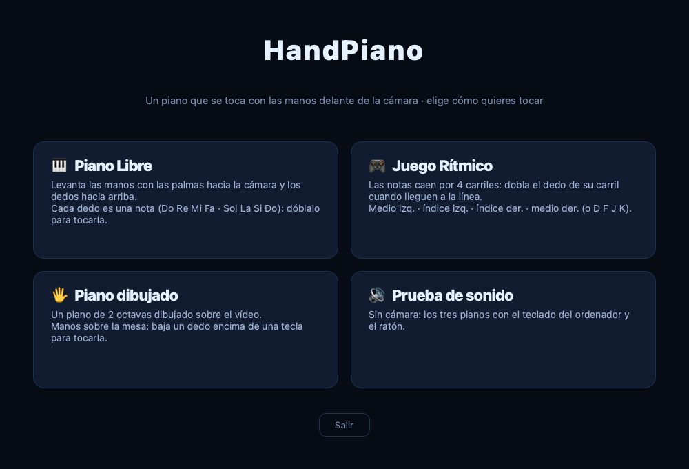
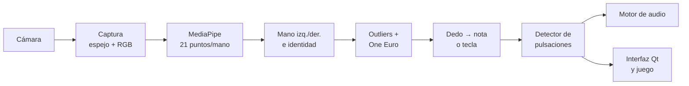

# 🎹 HandPiano

**Un piano virtual que se toca con las manos delante de la cámara del ordenador.**

HandPiano sigue tus manos con la webcam y convierte sus movimientos en notas de piano, con muestras de pianos reales (Grand, Upright y Electric). Al abrirla, un **menú** te deja elegir cómo tocar: **Piano Libre** (cada dedo es una nota y se toca doblándolo), **Juego Rítmico** con 4 canciones, **Piano dibujado** sobre el vídeo o **Prueba de sonido**. Todo se procesa **en tu ordenador**: no se guarda ni se envía ninguna imagen.


-lightgrey?logo=apple)

-41CD52?logo=qt&logoColor=white)




---

## Índice

1. [Qué hace y en qué estado está](#qué-hace-y-en-qué-estado-está)
2. [Instalación](#instalación)
3. [Inicio rápido: el menú](#inicio-rápido-el-menú)
4. [Los modos](#los-modos)
5. [Cómo colocarte](#cómo-colocarte)
6. [Controles de teclado](#controles-de-teclado)
7. [Todas las opciones de la línea de comandos](#todas-las-opciones-de-la-línea-de-comandos)
8. [Cómo funciona por dentro](#cómo-funciona-por-dentro)
9. [Qué se ha medido](#qué-se-ha-medido)
10. [Herramientas de medición y grabación](#herramientas-de-medición-y-grabación)
11. [Tests](#tests)
12. [Estructura del proyecto](#estructura-del-proyecto)
13. [Privacidad](#privacidad)
14. [Limitaciones conocidas](#limitaciones-conocidas)
15. [Créditos y licencias](#créditos-y-licencias)

---

## Qué hace y en qué estado está

**Funciona:**

- **Menú de inicio** con los cuatro modos; desde cada modo, **☰ Menú** vuelve a él.
- **Seguimiento de las dos manos** con MediaPipe Hand Landmarker: 21 puntos por mano y 8 dedos de juego (índice, medio, anular y meñique de cada mano), con identidad izquierda/derecha validada.
- **Dos formas de tocar:**
  - **Dedo = nota** (Piano Libre y Juego): cada dedo tiene su nota fija, de Do a Do, y suena al **doblarlo** con la palma hacia la cámara;
  - **Piano dibujado**: 2 octavas (C4–B5) dibujadas sobre el vídeo; suena la tecla que hay debajo del dedo que baja.
- **Guía en pantalla**: una barra en la parte de abajo del vídeo se pone **verde** cuando las manos están bien y, si no, dice qué corregir. En "dedo = nota" revisa la **postura** ("dedos hacia ARRIBA", "gira la palma hacia la cámara", "acerca la mano"…).
- **Medidor por dedo**: junto a cada punta de dedo, una barrita muestra cuánto se ha movido ese dedo; se pone verde cuando cuenta como nota. En "dedo = nota", encima de cada dedo aparece su nota (Do, Re, Mi…).
- **Sonido real**: tres pianos muestreados, motor polifónico propio, cambio de instrumento al vuelo y volumen.
- **Juego Rítmico 4K** con 4 canciones de dominio público, puntuación, combo y precisión.
- **Pruebas guiadas que se puntúan solas**: al terminar, la app dice cuántos toques reconoció de cada dedo, para comparar posturas y posiciones de cámara sin analizar nada a mano.
- **Teclado y ratón como alternativa**: siempre se puede tocar también con el teclado del ordenador.

**Lo que hay que saber (medido, no supuesto):** con la webcam del portátil, la cámara ve las manos casi todo el tiempo (97–100 %), pero **no siempre distingue qué dedo ha tocado**.
- **Piano dibujado:** en pruebas guiadas reconoce entre el 7 y el 22 % de los toques de un dedo concreto, según el ajuste.
- **"Dedo = nota":** en la prueba guiada con buena postura reconoce **34–35 de 40 toques (85–88 %)** en dos grabaciones distintas, frente a 4 de 40 del piano dibujado en la misma prueba. Tocando libre, en 35 s suena 33 veces. Está medido con una sola persona y una sola cámara.

Tocando libremente sí suena y responde, pero no como un piano real. Los números están en [Qué se ha medido](#qué-se-ha-medido).

---

## Instalación

Requisitos: macOS en Apple Silicon (la plataforma probada), Python 3.11–3.13 y una cámara.

```bash
git clone https://github.com/kcitas/hand-piann0.git
cd hand-piann0

python3.13 -m venv .venv
source .venv/bin/activate
python -m pip install -e ".[dev]"

# 1) Modelo de detección de manos (~7.8 MB; se verifica su SHA-256)
python scripts/download_model.py

# 2) Sonidos de los tres pianos (~110 MB en sounds/; se verifica la afinación de cada muestra)
python scripts/download_sounds.py
```

Estas dos descargas son las únicas veces que la app necesita Internet. El modelo y los sonidos no se suben al repositorio.

> - `mediapipe` ya instala su propio OpenCV. **No** instales `opencv-python` aparte: los dos aportan `cv2` y chocan.
> - Se usa `PySide6-Essentials`, no el paquete `PySide6` completo, que ocupa ~500 MB más sin aportar nada a la app.
> - **Permiso de cámara en macOS:** la primera vez, macOS pide permiso para la aplicación desde la que lanzas Python (Terminal, iTerm, VS Code…). Si lo deniegas, actívalo en *Ajustes del Sistema → Privacidad y seguridad → Cámara* y reinicia esa aplicación.

---

## Inicio rápido: el menú

```bash
source .venv/bin/activate
python -m handpiano
```

Se abre el **menú**. Haz clic en un modo para entrar. Dentro de cada modo, el botón **☰ Menú** (arriba a la izquierda) o cerrar la ventana te devuelven al menú. **Salir** cierra la app.

Con una opción de modo en la línea de comandos, la app entra directamente en ese modo, sin menú:

```bash
python -m handpiano --dedo-nota        # Piano Libre con "dedo = nota"
python -m handpiano --piano-mesa       # piano calibrado sobre la mesa
python -m handpiano --audio-test       # prueba de sonido sin cámara
python -m handpiano --lab              # piano dibujado con el Tracking Lab (estado de cada dedo en directo)
```

`--confianza 0.3` hace que la cámara pierda menos las manos y se puede añadir a cualquiera de ellos, también al menú.

---

## Los modos

### 🎹 Piano Libre (dedo = nota)

Cada dedo tiene su nota. Para tocarla, **dobla ese dedo** hacia la palma y vuelve a estirarlo; mientras está doblado, la nota sigue sonando. Varios dedos a la vez suenan como acorde.

```
Mano izquierda:  meñique Do  ·  anular Re  ·  medio Mi  ·  índice Fa
Mano derecha:    índice Sol  ·  medio La  ·  anular Si  ·  meñique Do (agudo)
```

La escala de Do mayor va de izquierda a derecha, como en un piano. El nombre de cada nota aparece encima de su dedo en el vídeo, y el teclado de arriba ilumina la tecla que suena. En este modo no se dibuja ningún piano sobre el vídeo, porque no hace falta.

### 🎮 Juego Rítmico

Las notas caen por 4 carriles; hay que tocarlas cuando llegan a la línea.

- **Con las manos ("dedo = nota"):** cada carril es un dedo, igual que D F J K en el teclado:
  - carril 1: medio izquierdo (o anular y meñique izquierdos);
  - carril 2: índice izquierdo;
  - carril 3: índice derecho;
  - carril 4: medio derecho (o anular y meñique derechos).
- **Con el teclado:** D F J K.
- **Juicio por tiempo:** PERFECT ±50 ms, GREAT ±100 ms, GOOD ±160 ms; fuera de eso, MISS. Al acertar suena la nota de la melodía.
- **Canciones incluidas** (en `songs/`, dominio público, transcritas para el juego y lentas para poder tocarlas con las manos):

| Hueco | Canción | Duración |
| --- | --- | --- |
| 1 | Himno de la Alegría (Beethoven) | ~26 s |
| 2 | Estrellita, ¿dónde estás? (tradicional) | ~36 s |
| 3 | Cumpleaños Feliz | ~21 s |
| 4 | Para Elisa, inicio (Beethoven) | ~25 s |

**Añadir canciones:** copia archivos `.mid` o `.json` en `songs/`. El juego usa los 4 primeros en orden alfabético, y los MIDI se reparten solos en los 4 carriles, de grave a agudo. El formato JSON está en [`songs/README.md`](songs/README.md) y en [`handpiano/game/chart.py`](handpiano/game/chart.py). Usa solo canciones cuya licencia lo permita.

### 🖐 Piano dibujado

Un piano de 2 octavas dibujado sobre el vídeo. Con las manos sobre la mesa, **baja un dedo** encima de una tecla: suena esa tecla mientras el dedo siga abajo. La fuerza del golpe (la velocidad con que baja el dedo) decide el volumen. Dentro de este modo también se puede cambiar al Juego Rítmico con los botones de arriba; ahí el piano se divide en 4 zonas iguales, una por carril.

### 🔊 Prueba de sonido

Sin cámara: los tres pianos con el teclado del ordenador y el ratón. Sirve para comprobar que el audio funciona.

---

## Cómo colocarte

La colocación importa más que cualquier ajuste. Con las muñecas fuera de la imagen, la cámara perdía las manos la mitad del tiempo; bien colocadas, las ve el 97–100 % del tiempo. **Espera siempre a que la barra de abajo esté verde.**

**Para los dos estilos:**
- **luz de frente**, sin una ventana detrás de ti;
- **las dos manos enteras en la imagen**, con las muñecas dentro.

**"Dedo = nota" (Piano Libre y Juego):**
- manos **levantadas**, con las **palmas mirando a la cámara** y los **dedos estirados hacia arriba**, como saludando; los codos pueden apoyarse en la mesa;
- **dobla cada dedo del todo** hacia la palma para tocar, y vuelve a estirarlo. Un gesto a medias no cuenta.

**Piano dibujado:**
- manos sobre la mesa, con las **puntas de los dedos sobre el piano dibujado**;
- **golpes claros**: baja el dedo 2–3 cm con decisión y vuelve a subirlo;
- **el índice y el medio son los que mejor se detectan**; el anular y el meñique se mueven muy poco en la imagen de una webcam frontal.

Mensajes de la barra:

| Mensaje | Modo | Qué hacer |
| --- | --- | --- |
| Manos bien colocadas (verde) | los dos | Nada: puedes tocar |
| Sube la mano X: la muñeca se sale de la imagen | los dos | Sube la mano o inclina la pantalla hacia delante |
| No veo la mano X | los dos | Pon la mano entera dentro de la imagen |
| Pon la mano X con los dedos hacia ARRIBA | dedo = nota | Gira la mano: dedos arriba, muñeca abajo |
| Gira la palma X hacia la cámara y estira los dedos | dedo = nota | La cámara ve los dedos "de canto" o doblados |
| Acerca / Aleja la mano X | dedo = nota | La mano se ve demasiado pequeña o demasiado grande |
| Sube / Baja la mano X: las puntas están por debajo / por encima del piano | piano dibujado | Lleva las puntas de los dedos al piano |
| Mueve la mano X hacia el piano | piano dibujado | La mano está a un lado del teclado |

---

## Controles de teclado

| Tecla | Acción |
| --- | --- |
| `1` `2` `3` | Instrumento: Grand, Upright, Electric |
| `−` / `+` | Bajar / subir volumen |
| `A W S E D F T G Y H U J K O L P Ñ` | Notas en Piano Libre (como un teclado de piano: fila de abajo blancas, de arriba negras) |
| `Z` / `X` | Bajar / subir una octava las notas del teclado |
| `D F J K` | Carriles 1–4 en el Juego Rítmico |
| Ratón | Clic en una tecla del piano para tocarla |

**Durante la calibración del piano sobre la mesa:** `Espacio` captura la esquina, `Retroceso` deshace la última y `Esc` cancela.

---

## Todas las opciones de la línea de comandos

| Opción | Qué hace |
| --- | --- |
| *(ninguna opción de modo)* | Abre el **menú** de inicio |
| `--camera N` | Índice de la cámara (por defecto `0`) |
| `--width W --height H` | Resolución pedida (por defecto `1280×720`) |
| `--fps F` | FPS pedidos (por defecto `30`; la cámara puede entregar otro valor) |
| `--no-mirror` | Vista sin espejo |
| `--confianza C` | Confianza mínima de MediaPipe para detectar y seguir manos, entre 0 y 1 (por defecto 0.5). Más baja pierde menos las manos, pero puede ver manos donde no las hay |
| `--dedo-nota` | Entra directamente en Piano Libre con "dedo = nota" (cada dedo una nota; se toca doblándolo) |
| `--solo-indices` | Solo suenan los dos dedos índice; los otros dedos se ignoran |
| `--piano-mesa` | Usa el piano calibrado sobre la mesa en vez del piano fijo en pantalla |
| `--start-note NOTA --octaves N` | Teclado (por defecto `C4` y `2` octavas); debe empezar y terminar en tecla blanca |
| `--instrument grand\|upright\|electric` | Instrumento inicial |
| `--no-audio` | Sin sonido |
| `--audio-test` | Prueba de sonido sin cámara: los tres instrumentos con teclado y ratón |
| `--microfono` | Experimental: el micrófono detecta el instante del toque sobre la mesa y la cámara decide qué dedo fue |
| `--lab` | Abre el Tracking Lab (estado, profundidad y eventos de cada dedo) |
| `--check-hands` | Validación guiada de mano izquierda/derecha con instrucciones en pantalla |
| `--check-keys [--check-keys-csv RUTA]` | Prueba guiada de precisión dedo → tecla (necesita el piano sobre la mesa calibrado) |
| `--record-trace RUTA --trace-protocol P` | Graba una sesión de medición guiada (solo números, nunca imágenes). Ver [Herramientas](#herramientas-de-medición-y-grabación) |
| `--debug-notes` | Una línea en la terminal por cada nota: dedo → tecla → motor de audio, con tiempos |
| `--debug-keys` | Una línea en la terminal por cada tecla física que llega a la app |
| `-v` | Registro detallado |

### Piano sobre la mesa (`--piano-mesa`)

En lugar del piano fijo en pantalla, puedes colocar el piano donde quieras marcando sus 4 esquinas con el índice:

1. Pulsa **«Calibrar piano»** y usa **una sola mano**.
2. Marca con el índice, en este orden, las esquinas **superior izquierda → superior derecha → inferior derecha → inferior izquierda**. El borde superior es el de las teclas negras.
3. En cada esquina, mantén el dedo quieto 1,2 s, hasta que se complete el anillo amarillo.

Solo se guardan las 4 coordenadas, en `~/Library/Application Support/HandPiano/calibration.json`, y únicamente se reutilizan con la misma cámara, resolución y modo espejo. **«Olvidar calibración»** la borra. Si mueves la cámara, recalibra.

---

## Cómo funciona por dentro



1. **Captura** (hilo `camera-capture`): lee la cámara, refleja la imagen y deja **solo el último frame** en una ranura. Si llega uno nuevo antes de procesar el anterior, el viejo se descarta: se pierde frame rate, nunca se acumula retraso.
2. **Detección** (hilo `tracking`): MediaPipe estima 21 puntos por mano. Con la vista espejo se invierte su etiqueta para obtener tu mano física, y una identidad temporal evita que las manos se intercambien.
3. **Limpieza**: se descartan saltos imposibles (outliers) y se suaviza con un **One Euro Filter**. Cada dedo queda `TRACKED`, `HELD` (sin datos ≤ 120 ms) o `LOST`.
4. **Dedo → nota**: en "dedo = nota" cada dedo tiene su nota fija (Do4 … Do5). En el piano dibujado, la punta de cada dedo se lleva a coordenadas de piano y se mira qué tecla hay debajo (las negras tienen prioridad); en el piano sobre la mesa se usa una homografía con las 4 esquinas.
5. **Pulsación**: la misma máquina de estados por dedo en los dos estilos (`IDLE → PRESS_CANDIDATE → PRESSED → RELEASE_CANDIDATE`), con una señal medida respecto al nudillo y dividida por el tamaño de la mano, así que mover la mano entera no la cambia. Una línea base sigue la postura en reposo, y se resta el movimiento común de la mano para no disparar notas al mover la mano entera.
   - **Piano dibujado:** la señal es cuánto **baja** la punta. Pulsa por encima de 0,12 tamaños de mano, con velocidad suficiente durante 2 frames, y suelta por debajo de 0,06.
   - **"Dedo = nota":** la señal es cuánto se **acorta** el dedo en la imagen. Al doblarlo hacia una cámara que mira la palma, su longitud aparente cae de ~1,4 a menos de 1 palma. Pulsa por encima de 0,35 y suelta por debajo de 0,175, con al menos 0,25 s entre dos notas del mismo dedo, sin velocidad mínima, y del movimiento de la mano solo se restan los dedos quietos; son valores medidos con la prueba guiada y tocando libre (ver [Qué se ha medido](#qué-se-ha-medido)).
6. **Sonido**: cada pulsación encola un `note_on` en el motor de audio (numpy + PortAudio vía `sounddevice`), que mezcla las voces en su propio hilo. Nada bloquea la cámara ni la interfaz.
7. **Interfaz** (hilo principal de Qt): solo lee el último resultado y pinta vídeo, piano, barra de colocación, medidores y juego.

El detalle completo (espacios de coordenadas, homografía, geometría del teclado, máquina de estados, correcciones del detector, métricas, latencia, CPU, jitter, modos de cámara) está en **[docs/TECNICO.md](docs/TECNICO.md)**.

---

## Qué se ha medido

Todas las cifras salen de grabaciones reales con esta app y la webcam frontal de un MacBook, reproducidas con el detector de producción.

| Qué | Resultado |
| --- | --- |
| Manos vistas con buena colocación (`tocar_3`, `tocar_4`) | 97–100 % del tiempo, cada mano |
| Manos vistas con las muñecas fuera de la imagen (`dedos_4`) | 46 % (izquierda) y 86 % (derecha) |
| Del frame capturado a la voz sonando en el motor | 9–18 ms (`--debug-notes`) |
| Toques guiados reconocidos, 240 toques en 6 sesiones, detector por defecto | 18/240 (7,5 %), 56 notas de más |
| El mejor ajuste encontrado en esas 6 sesiones | 53/240 (22 %), pero 145 notas de más |
| Tocando libremente (≈ 2 min) | 116 notas, todas llegaron al motor de audio, ninguna se quedó pegada |
| "Dedo = nota", prueba guiada con postura correcta (`notas_3`; mano izquierda poco visible) | **34/40 (85 %)**, 29 notas de más |
| "Dedo = nota", segunda grabación (`notas_4`; las dos manos bien colocadas el 92–96 % del tiempo) | **35/40 (88 %)**, 27 notas de más |
| "Dedo = nota" tocando libre 35 s (`libre_1`) | 33 notas (antes de restar solo los dedos quietos: 22) |
| "Dedo = nota", `notas_3` con el umbral de partida 0,5 | 18/40 (45 %), 8 notas de más |
| "Dedo = nota" con mala postura (`notas_1`, `notas_2`: manos fuera de la imagen) | 0–3/40: la postura decide más que el umbral |

**Lectura:**

- El problema **no** es ver la mano: es distinguir qué dedo ha bajado. Un toque sobre la mesa mueve la punta del dedo 0,03–0,10 tamaños de mano en la imagen, y los dedos vecinos se mueven casi lo mismo.
- Ningún umbral lo arregla. Bajar umbrales gana algunos aciertos a cambio de muchas más notas falsas, así que los valores por defecto no se han cambiado.
- Es coherente con la investigación ([docs/INVESTIGACION_PULSACIONES.md](docs/INVESTIGACION_PULSACIONES.md)): ni en nuestras grabaciones ni en el dataset PianoVAM (pulsaciones reales medidas por MIDI) hay una señal geométrica por frame que separe bien el dedo que pulsa de sus vecinos.

**Lo que más podría mejorarlo, por orden:**

1. **Un gesto más visible que un toque:** **doblar el dedo** con la palma hacia la cámara. Es el modo "dedo = nota", que pasó de 4/40 a 32/40 en la misma prueba guiada.
2. **Otra posición de cámara:** a la altura de la mesa, mirando los dedos de lado, para que el movimiento de bajar el dedo se vea entero. Un móvil sirve como webcam.
3. **Una cámara de profundidad.**

---

## Herramientas de medición y grabación

Las grabaciones guardan **solo números** (posiciones de los puntos de la mano y estado del detector), nunca imágenes. La app se niega a sobrescribir un archivo existente.

```bash
# Prueba guiada: 5 toques con cada dedo (~1 min 40 s); en pantalla se dice qué dedo tocar
python -m handpiano --record-trace dedos_7.csv --trace-protocol dedos

# La misma prueba en "dedo = nota" (doblando los dedos)
python -m handpiano --dedo-nota --record-trace notas_2.csv --trace-protocol dedos

# Prueba guiada solo de los índices: 10 toques con cada uno (~50 s)
python -m handpiano --record-trace indices_1.csv --trace-protocol indices --solo-indices

# 35 s tocando libremente
python -m handpiano --record-trace tocar_5.csv --trace-protocol play
```

| Protocolo | Qué pide |
| --- | --- |
| `dedos` | 5 toques guiados con cada uno de los 8 dedos, uno cada 2 s |
| `indices` | 10 toques guiados con cada índice, uno cada 2 s |
| `play` | 30 s tocando libremente |
| `keys` | Dedos sobre el teclado del ordenador: cada tecla real queda como etiqueta independiente |
| `v2`, `focus` | Protocolos anteriores: avisos cada 1,5 s y dedos problemáticos cada 3 s |

**Al terminar una prueba guiada (`dedos` o `indices`), la app dice cuántos toques reconoció**, en pantalla y en la terminal:

```
Toques reconocidos: 4/40 (10%) · notas de más: 9
índice izq 2/5 · medio izq 1/5 · anular izq 0/5 · meñique izq 0/5 · índice der 0/5 · …
```

Así se pueden comparar posturas, distancias y posiciones de cámara: graba varias veces, cambiando una sola cosa cada vez, y quédate con la que más toques reconozca.

Cada grabación escribe `NOMBRE.csv` (por dedo y frame), `NOMBRE.landmarks.csv` (los 21 puntos), `NOMBRE.meta.json` (ajustes usados) y, si se pulsaron teclas físicas, `NOMBRE.labels.csv`. El formato está en [docs/TRAZAS_V4_Y_ETIQUETAS.md](docs/TRAZAS_V4_Y_ETIQUETAS.md).

| Script | Qué hace |
| --- | --- |
| `scripts/download_model.py` | Descarga el modelo y verifica su SHA-256 |
| `scripts/download_sounds.py` | Descarga las muestras de los tres pianos y verifica la afinación |
| `scripts/audio_check.py` | Diagnóstico de audio: arpegio, retrasos y cortes |
| `scripts/analyze_trace.py` | Resumen por dedo de una grabación, avisos y tramos atascados |
| `scripts/compare_detectors.py` | Reproduce una grabación con el detector anterior y el actual |
| `scripts/benchmark_signals.py` | Qué señal separa mejor el dedo que pulsa de sus vecinos (AUC) |
| `scripts/benchmark_landmarks.py` | Lo mismo con todas las características de los 21 puntos, frente a etiquetas independientes |
| `scripts/benchmark_pianovam.py` | El mismo benchmark sobre el dataset PianoVAM |
| `scripts/check_trace_keys.py` | Comprueba que las teclas físicas llegan a la grabación (`--manual`, `--camera`) |
| `scripts/camera_matrix.py` | Qué resolución y FPS entrega de verdad la cámara |
| `scripts/profile_cpu.py` | CPU por componente y latencias internas |
| `scripts/evaluate_smoothing.py` | Evaluación del One Euro Filter frente a una media móvil |

---

## Tests

```bash
python -m pytest -q
```

Más de 450 tests, sin cámara física: la cámara, MediaPipe y la salida de audio se sustituyen por dobles con datos controlados. Cubren entre otras cosas:

- **seguimiento:** captura, ciclo de vida de los hilos, identidad izquierda/derecha y outliers;
- **piano:** geometría del teclado y hit testing;
- **calibración:** homografía y calibración;
- **pulsaciones:** detector con manos sintéticas, modo solo índices y modo "dedo = nota";
- **mediciones:** grabaciones v4 y etiquetas, resumen de pruebas guiadas, guía de colocación y de postura;
- **menú:** sus cuatro modos y la vuelta al menú, cerrando el modo sin dejar nada en marcha;
- **audio:** carga de muestras, mezclador, motor y paso pulsación → sonido;
- **juego:** partituras JSON y MIDI, juicio y puntuación;
- **interfaz:** modo offscreen.

---

## Estructura del proyecto

```
hand-piann0/
├── handpiano/
│   ├── app/            Arranque, menú y opciones (main.py), controlador (application.py), hilos (pipeline.py),
│   │                   piano en pantalla y calibración, guía de colocación y postura, pulsación → sonido
│   ├── camera/         Apertura de la cámara, hilo de captura, ranura del último frame
│   ├── tracking/       MediaPipe, 21 puntos, identidad izquierda/derecha, One Euro, estado de los dedos
│   ├── instrument/     Notas y geometría del teclado
│   ├── mapping/        Homografía, calibración, dedo → tecla, prueba de precisión
│   ├── interaction/    Detector de pulsaciones, grabaciones de medición, etiquetas, benchmarks
│   ├── audio/          Instrumentos, carga de muestras, mezclador, motor de audio, micrófono
│   ├── game/           Partituras y juego rítmico
│   ├── metrics/        Estadísticas, FPS, CPU
│   └── ui/             Menú de inicio, ventana, vídeo, piano, Tracking Lab, instrumentos, juego
├── songs/              Canciones del juego (.json / .mid)
├── scripts/            Descargas y herramientas de medición
├── tests/
├── docs/               TECNICO.md, AUDIO.md, INVESTIGACION_PULSACIONES.md, TRAZAS_V4_Y_ETIQUETAS.md, img/
├── models/             Modelo descargado (no se sube al repositorio)
├── sounds/             Muestras descargadas (no se suben al repositorio)
└── pyproject.toml
```

---

## Privacidad

- Todo se procesa en el ordenador: MediaPipe corre en local, en la CPU.
- La app **no** sube vídeo ni envía imágenes o puntos de la mano a ningún sitio, y **no** guarda frames en disco. Las grabaciones de medición guardan solo números.
- No hay reconocimiento facial ni identificación de personas: solo se detectan manos.
- Las grabaciones de medición (`*.csv`, `*.meta.json` en la raíz) están en `.gitignore` y no se suben al repositorio.

---

## Limitaciones conocidas

- **Qué dedo toca:** con una webcam frontal, el detector reconoce una minoría de los toques individuales (ver [Qué se ha medido](#qué-se-ha-medido)). El anular y el meñique son los peores.
- **"Dedo = nota":** medido con una sola persona y cámara (34–35/40 en dos grabaciones). Quedan notas de más (27–29 por cada 40 toques): sobre todo al colocarse o entre toques, y a veces suena también el dedo vecino. Solo hay 8 notas (Do–Do, sin sostenidos ni pulgares).
- **FPS:** la webcam probada entrega ~24 fps, y eso limita todo el sistema.
- **Latencia física:** medida hasta el motor de audio (9–18 ms), pero no hasta el oído. El procedimiento está en [docs/AUDIO.md](docs/AUDIO.md).
- **Micrófono (`--microfono`):** experimental; en la prueba real detectó pocos toques y con unos 120 ms de retraso.
- **Piano sobre la mesa:** la homografía solo es exacta en el plano de las 4 esquinas, y la precisión dedo → tecla no se ha medido con una persona.
- **Izquierda/derecha:** validado con una persona, una cámara y una iluminación, solo en vista espejo.
- **Plataforma:** solo probado en macOS con Apple Silicon. Windows no está probado.
- **Ruta del modelo:** se busca en `<raíz del proyecto>/models/`, así que hace falta la instalación editable (`pip install -e`), que es la documentada.

El historial completo de problemas encontrados y corregidos está en [docs/TECNICO.md](docs/TECNICO.md#historial-de-limitaciones-y-mediciones).

---

## Créditos y licencias

- **Detección de manos:** [MediaPipe Hand Landmarker](https://ai.google.dev/edge/mediapipe/solutions/vision/hand_landmarker) (Google, Apache 2.0).
- **Sonidos**, descargados por `scripts/download_sounds.py`, con la procedencia detallada en [docs/AUDIO.md](docs/AUDIO.md):
  - Grand: Steinway B de VCSL (CC0);
  - Upright: vertical Knight de VCSL (CC0);
  - Electric: Rhodes Mark I de jRhodes3d (CC BY-NC 4.0, **uso no comercial**).
- **Canciones** del juego: melodías de dominio público transcritas para HandPiano.
