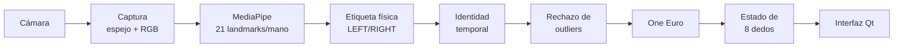
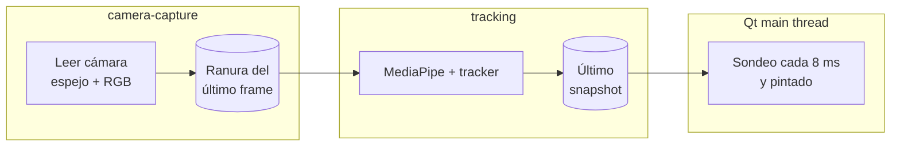

# HandPiano: documentación técnica

Detalle de cómo funciona por dentro HandPiano y de todo lo que se ha medido. La guía de uso está en el [README](../README.md).

Contenido: cómo funciona el seguimiento · mapeo espacial y calibración · detección de pulsaciones · validación LEFT/RIGHT · métricas · latencia · CPU · jitter · One Euro · modos de cámara · historial de limitaciones.

Las fechas son de 2026. Los resultados de los días 13–15 de octubre (piano en pantalla, colocación, pruebas guiadas `dedos`) están resumidos en el README y en [INVESTIGACION_PULSACIONES.md](INVESTIGACION_PULSACIONES.md).

## Cómo funciona



### Hilos



- **`camera-capture`** lee la cámara, refleja el frame y lo convierte a RGB. Después lo deja en una ranura que guarda **un solo frame**. Si llega uno nuevo antes de que se procese el anterior, el anterior se sobrescribe y se cuenta como descartado.
- **`tracking`** carga MediaPipe, abre la cámara y arranca el hilo de captura. Luego procesa siempre el frame más reciente y publica un *snapshot* inmutable: los arrays se publican en solo lectura. Es el único hilo que libera la cámara, y lo hace después de que termine la captura.
- **El hilo principal de Qt** solo lee el último snapshot. Nunca ejecuta MediaPipe ni modifica el estado del tracker.
- `stop()` cierra ambos hilos e informa si alguno no terminó a tiempo. Hay tests que verifican que reiniciar la cámara no deja hilos huérfanos y que detenerla durante la apertura la libera.

### Pasos del tracking

1. **Detección.** MediaPipe (modo VIDEO) estima 21 puntos por mano. `x, y` están normalizados a la imagen (0–1); `z` es una profundidad aproximada relativa a la muñeca.
2. **Etiqueta física.** MediaPipe etiqueta la mano según cómo *se ve* en la imagen, y una mano derecha reflejada parece una izquierda. Por eso, con la vista espejo (opción por defecto), la etiqueta se invierte para obtener la mano física del usuario. Ver [Validación LEFT/RIGHT](#validación-leftright).
3. **Identidad temporal.** Se aplican tres reglas:
   - dos manos con etiquetas distintas → se usan las etiquetas;
   - dos manos con la misma etiqueta → se separan por posición (con espejo, la izquierda del usuario aparece a la izquierda de la imagen);
   - una sola mano → conserva su identidad salvo que el detector diga lo contrario durante 6 frames seguidos.
4. **Outliers.** Si la mediana de los landmarks se mueve a más de 8 anchos de imagen por segundo, se ignora ese frame. Si el salto persiste más de 2 frames, se acepta.
5. **One Euro Filter** sobre los 21 puntos.
6. **Estado de los dedos.** Cada dedo tiene un estado `TRACKED` (datos frescos), `HELD` (sin datos durante ≤ 120 ms, se conserva la última posición) o `LOST`. Además se calculan la posición, la velocidad y el jitter.

Todos los parámetros están centralizados en [`handpiano/app/config.py`](../handpiano/app/config.py) y en las clases `*Config`.

> El sistema **estima** la posición de los dedos a partir de landmarks de visión por computador. No es una medición física.

## Arquitectura del mapeo espacial

```text
MediaPipe (21 landmarks por mano)
   ↓
Posición de la punta del dedo (suavizada, One Euro)
   ↓
Coordenadas de cámara      x, y ∈ [0, 1] del frame mostrado (espejado)
   ↓
Calibración / homografía   4 esquinas marcadas por el usuario
   ↓
Coordenadas de piano       x ∈ [0, 14), y ∈ [0, 6.38)   en anchos de tecla blanca
   ↓
Hit testing de teclas      key_at(x, y): negras primero
   ↓
Hover visual               teclado encima del vídeo + teclas proyectadas sobre la imagen
```

> **La calibración es 2D. La coordenada Z de MediaPipe no representa una distancia física calibrada** y no se usa. Nada en HandPiano conoce centímetros reales.

### Espacios de coordenadas

| Espacio | Unidades | Origen | Dónde |
| --- | --- | --- | --- |
| Cámara | fracción del ancho y del alto del frame espejado | arriba a la izquierda | `FingerState.tip` |
| Piano | anchos de tecla blanca | esquina trasera izquierda del teclado (lado de las negras) | `instrument/keyboard.py` |
| UI | píxeles del widget | arriba a la izquierda del widget | `ui/piano_view.py`, `ui/camera_view.py` |

Transformaciones:
- **Cámara → piano:** homografía `H` (3×3) calculada con las 4 esquinas. `P1 → (0, 0)`, `P2 → (W, 0)`, `P3 → (W, H)`, `P4 → (0, H)`.
- **Piano → cámara:** `H⁻¹`, calculada aparte. Se usa para dibujar las teclas sobre el vídeo; los polígonos se calculan una vez por calibración, no en cada frame.
- **Piano → UI (teclado de arriba):** `ui_x = margen + x · sx`, `ui_y = margen + y · sy`, con escalas independientes para llenar el panel. Solo afecta al dibujo.
- **Cámara → UI (vídeo):** el frame se ajusta al widget conservando su proporción.

### Por qué una homografía y no una transformación afín

Un rectángulo plano visto en perspectiva aparece en la imagen como un cuadrilátero cualquiera, con el lado lejano más corto. Una afín conserva el paralelismo y no puede corregir eso; una homografía sí. Un test verifica que el centro del teclado cae en el cruce de las diagonales del cuadrilátero y no en el promedio de sus esquinas.

**Limitación:** la homografía solo es exacta para puntos que están **en el plano** de las 4 esquinas. Un dedo por encima o por debajo de ese plano se proyecta con un error de paralaje que crece con la distancia al plano y con el ángulo de la cámara. Si las esquinas se marcan en el aire, el "plano" es el que forman esos 4 puntos. Este error no se ha medido.

### Geometría del teclado

- Las teclas blancas ocupan `[i, i + 1)` en `x` y todo el fondo `[0, 6.38)` en `y`. Las proporciones son las de un piano real (blanca 23.5 × 150 mm, negra 13.7 × 95 mm), **pero son proporciones, no medidas reales**.
- Las teclas negras están centradas en la frontera entre sus dos blancas vecinas (C♯, D♯, F♯, G♯, A♯). Los pianos reales desplazan ligeramente algunas; ese detalle no se modela.
- **Bordes** (intervalos semiabiertos `[x, x + w) × [y, y + h)`):
  - el borde izquierdo y el superior pertenecen a la tecla; el derecho y el inferior no;
  - en la frontera entre dos blancas gana la de la derecha;
  - `x == ancho` o `y == fondo` queda fuera del teclado;
  - fuera del teclado, en coordenadas negativas o NaN, `key_at` devuelve `None`.
- **No hay zonas muertas:** los huecos entre teclas son solo visuales.
- **Prioridad:** las negras se comprueban primero, así que donde una negra se solapa con una blanca, gana la negra.

### Mapeo de los 8 dedos

- Cada dedo se mapea de forma **independiente**: la tecla depende solo de su posición, así que el índice izquierdo puede estar en C4 en un frame y en G4 en el siguiente.
- **Dos dedos sobre la misma tecla** se agrupan en `keys_under` sin crear una segunda nota. En la UI la tecla se reparte entre los colores de ambas manos.
- **Sin calibración no hay mapeo:** todas las teclas son `None`. La UI muestra "Calibración necesaria" y el Lab muestra `N/A`; nunca se supone, por ejemplo, que "la parte inferior de la imagen es el piano".
- **Distancia al centro:** es la distancia, en anchos de tecla, entre el dedo y el centro geométrico de la tecla detectada. **No es un error**, porque no hay un objetivo conocido.
- **Dónde se ejecuta:** el mapeo corre en el hilo de tracking, justo después del estado de los dedos, y entra en el snapshot. Así la fase H lo tendrá disponible sin depender de la UI.

### Medición de precisión dedo → tecla

```bash
python -m handpiano --check-keys --check-keys-csv precision.csv
```

`--check-keys` es una **herramienta de medición, no una calibración**:
- Usa la calibración guardada.
- Desactiva «Calibrar piano» y «Olvidar calibración» durante la prueba.
- Si no hay una calibración válida para esta cámara, resolución y modo espejo, muestra `No valid calibration found. Run the normal calibration first.`, explica el motivo y **cierra la app con código 1 sin calibrar**.

**Puntos de prueba.** Son deterministas y están definidos en coordenadas de piano a partir de la geometría, nunca en coordenadas de cámara arbitrarias. Con 2 octavas son 22:

| Tipo | Puntos |
| --- | --- |
| Blancas (centro) | 7: C4, E4, G4, B4, D5, F5 y A5 |
| Negras (centro) | 5 |
| Bordes | 6: a 0.2 teclas a cada lado de las fronteras E\|F y B\|C, y justo dentro y justo debajo de una negra |
| Fuera del piano | 4: arriba, abajo, izquierda y derecha |

La tecla esperada de cada punto es `key_at(punto)`. Los puntos cuya proyección cae fuera de la imagen se omiten y se avisa en el log.

**Cómo se toma cada muestra:**
1. El punto se dibuja sobre el vídeo (una cruz amarilla) y su tecla se resalta.
2. Colocas el índice de **una sola mano** encima.
3. Cuando el dedo lleva 0.6 s estable (y al menos 1.5 s en ese objetivo), se toma **una muestra**: la posición media pasa por `KeyMapper.map_points`, la misma homografía y el mismo `key_at` que se usan en cada frame.
4. **Tras cada muestra, el dedo tiene que moverse** al menos 0.012 anchos de imagen (≈ 15 px) antes de la siguiente, salvo que el nuevo objetivo esté justo al lado. Sin esta regla, un dedo que seguía en el objetivo anterior se registraba para los siguientes; ocurrió en la primera ejecución real.
5. Si en 15 s no hay un dedo estable, la muestra es `miss` y se anota el motivo dominante (`miss_reason`):
   - `no_index`: no se veía ningún índice;
   - `two_hands`: se veían dos manos;
   - `unstable`: el dedo no se quedaba quieto;
   - `did_not_move`: el dedo no salió del objetivo anterior.

   El CSV incluye también los contadores de cada motivo.

Teclas: **Espacio** captura al instante y **Esc** termina con resultados parciales.

**Categorías de error:**

| Tipo de punto | Categoría | Significado |
| --- | --- | --- |
| Tecla | `exact` | Detectada = esperada |
| Tecla | `adjacent` | Una tecla cuyo rectángulo toca el de la esperada |
| Tecla | `far` | Cualquier otra tecla |
| Tecla | `miss` | Sin detección válida |
| Fuera | `outside_correct` | Ninguna tecla |
| Fuera | `outside_false_positive` | Se detectó una tecla |
| Fuera | `miss` | Sin dedo |

**Resultado:**
- se imprime en la terminal (`=== KEY ACCURACY ===` / `=== OUTSIDE DETECTION ===`) y se resume en la ventana;
- el CSV opcional tiene una fila por muestra: `sample_id`, `expected_key`, `detected_key`, `correct`, `error_category`, `finger`, `timestamp`, posiciones y distancia al centro objetivo.

El resultado solo vale si la persona apuntó a los puntos indicados. **Esta prueba aún no se ha completado con una persona** (ver [Limitaciones](#historial-de-limitaciones-y-mediciones)).

## Detección de pulsaciones (sin sonido)

**Diagnóstico** (11 de octubre de 2026, con el código y con `precision2.csv`):
- **Causa de "se activan otras teclas":** antes no existía la pulsación. Cada dedo con posición sobre el teclado iluminaba su tecla, así que al bajar un dedo para tocar, los otros tres dedos de esa mano, que también estaban encima, aparecían "activos".
- **El gesto de tocar mueve la punta en la imagen** y podía cambiar de tecla a mitad del gesto, sobre todo en vertical. En `precision2.csv` el eje x del dedo es preciso (−0.11 a +0.06 teclas en las blancas), pero el eje y tiene un desplazamiento sistemático de +1.2 a +2.4 teclas hacia delante.
- **Los 4 "falsos positivos fuera" no son un defecto del mapeo.** El dedo estaba a 50–153 px de la cruz, todavía dentro del teclado: la prueba registró pausas a mitad del trayecto.

**Diseño** (`handpiano/interaction/`):

| Pieza | Qué hace |
| --- | --- |
| `press_features.py` | Tres señales **relativas a la mano** (punta respecto a su nudillo, dividida por el tamaño de la mano): `tip_y` (vertical de la imagen), `flex` (longitud aparente del dedo) y `tip_z` (profundidad relativa de MediaPipe). Mover la mano entera no las cambia |
| `press_detector.py` | Una máquina de estados **por dedo**: `IDLE → PRESS_CANDIDATE → PRESSED → RELEASE_CANDIDATE` |
| `stable_keys.py` | Histéresis de tecla: el dedo conserva su tecla mientras no se aleje más de 0.08 teclas; fuera del teclado siempre es `None` |
| `finger_presses.py` | Ejecuta los 8 detectores en el hilo de tracking, en cada frame |

Cómo funciona la máquina de estados:
- **Umbrales:** pulsa si la profundidad supera `press_on` (0.12 tamaños de mano) bajando a más de `min_velocity` (0.8/s) durante 2 frames. Libera si queda por debajo de `release_off` (0.06) durante 2 frames. La diferencia entre ambos umbrales evita el parpadeo pulsado/suelto.
- **Línea base:** sigue lentamente la postura en reposo, así que una deriva lenta no es una pulsación.
- **Tecla:** se fija cuando **empieza** el gesto, antes de que el propio movimiento arrastre la punta a otra tecla.
- **Repetición:** mantener el dedo quieto no repite la nota; para volver a tocar hay que liberar, y después hay un periodo refractario de 80 ms (**por dedo**).
- **Rechazos**, cada uno con su motivo en el Lab:
  - fuera del teclado (`outside`);
  - sin calibración;
  - gesto demasiado corto;
  - mano entera moviéndose rápido (`hand_moving`).
- **Seguimiento perdido, hueco temporal o identidad de mano dudosa:** el dedo se reinicia, y si estaba pulsado se libera (`tracking_lost`). Nunca se dispara con datos viejos.

**En la interfaz:**
- una tecla **pulsada** se rellena con el color de la mano; una tecla que solo tiene un dedo encima lleva un contorno fino;
- en el Lab, cada dedo muestra su estado, profundidad y velocidad, y abajo aparecen los últimos eventos con su motivo.

**Defectos demostrados con `traza_v2.csv` y corregidos** (11 de octubre):

| Defecto | Corrección | Parámetro |
| --- | --- | --- |
| La línea base solo se adaptaba si `d < press_on`, así que tras un cambio de postura no se recuperaba | En reposo, con el dedo quieto, aprende la postura sea cual sea `d`, más rápido cuando está lejos (τ = 0.3 s). En PRESSED sigue congelada, para no aprender una pulsación como reposo | `baseline_any_depth`, `baseline_recover_tau_s` |
| La línea base sobrevivía a la pérdida de seguimiento | Se olvida al perder la mano, y el dedo no se arma hasta tener 4 frames quietos que validen la referencia nueva | `relearn_after_loss`, `relearn_still_frames` |
| No se restaba el movimiento común de la mano | Por mano: `cm` = segunda profundidad más baja × 1.5. Solo reduce la profundidad usada para **decidir** (nunca por debajo del reposo), mientras la línea base sigue aprendiendo de la señal cruda | `common_mode="hand_low"`, `common_mode_gain` |
| — | Tiempo máximo de pulsación: **desactivado**, porque cortaría notas sostenidas legítimas | `max_press_s=None` |

`PressConfig.legacy()` reproduce exactamente el detector anterior.

**Limitaciones del modo común:**
- un acorde de 3 o 4 dedos de la misma mano se suprime como si fuera un cambio de postura;
- un cambio de postura en el que un dedo se mueve más de 1.5 veces que los demás todavía puede disparar;
- con menos de 3 dedos de la mano a la vista no se aplica.

**Reproducción A/B de `traza_v2.csv`** (`python scripts/compare_detectors.py traza_v2.csv`; mismos umbrales y señal `tip_y`):

| Configuración | Pulsaciones | Intencionadas | No intencionadas | Avisos acertados | Omitidos | Extra | Máx. PRESSED | Tramos > 3 s |
| --- | --- | --- | --- | --- | --- | --- | --- | --- |
| Anterior | 55 | 30 | 25 | 26/76 | 50 | 30 | 20.0 s | 25 |
| Corregido | 50 | 33 | 17 | 29/76 | 47 | 25 | 7.3 s | 2 |

**Lectura:**
- Los atascos casi desaparecen, y la mejora no viene de suprimir pulsaciones: hay **más** aciertos y **menos** pulsaciones no intencionadas.
- El modo común, activado solo, es contraproducente (0/76); solo funciona junto con la recuperación de la línea base.

**Sigue fallando:** 47 de 76 avisos no tienen pulsación. En 26 de ellos la señal apenas se movió. Midiendo la excursión de cada señal en el aviso:
- `tip_y`: mediana **0.078** en los omitidos frente a **0.78** en los detectados;
- `flex`: se comporta igual;
- en 18 de esos 45 avisos ninguna de las tres señales llega a 0.12.

Cambiar de señal no lo arreglaría. Sin una referencia independiente de la visión no se puede saber si en esos avisos hubo toque. Otros 9 avisos se perdieron porque el dedo seguía desarmado, reaprendiendo la línea base tras perder la mano: es el coste de la corrección.

**Diagnóstico con `traza_v3.csv`** (grabación nueva, no usada para corregir el detector):

- **Las correcciones se mantienen con datos nuevos.** Frente al detector anterior: avisos acertados 8 → 25 de 76, tramos PRESSED de más de 3 s 29 → 10, máximo 52.7 s → 22.8 s.
- **Motivos de omisión por dedo** (`analyze_trace.py`):
  - RIGHT_MIDDLE (0/8): sin movimiento visible en **ninguna** señal (7 de 8 avisos), igual que en v2;
  - LEFT_RING (0/8): movimiento en `flex` pero no en `tip_y` (4); además, el modo común anuló 2 toques porque el índice y el medio estaban pulsados y retenidos;
  - RIGHT_RING: seguimiento inestable (reaprendiendo la referencia 4, sin seguimiento 2);
  - RIGHT_INDEX: ya estaba pulsado (5).
- **Las causas de los tramos largos ahora se basan en evidencia**, y la etiqueta `posture_jump` desaparece: era un valor por defecto, no una causa.
  - 5 `hand_comovement`: otros dedos de la mano suben a la vez. Es una correlación, no una prueba de la intención.
  - 3 `uninstructed_single`: un vecino no indicado se queda flexionado, hasta 22.8 s.
  - 2 `instructed_hold`: el dedo indicado no vuelve a su reposo.
- **Ni la misma señal ni el mismo umbral sirven para todos los dedos** (relación amplitud/ruido en v2 + v3):
  - índices: bien con `tip_y` y `flex` (3–8);
  - LEFT_RING: `tip_y` 0.5 frente a `flex` 2.6;
  - medios: < 1.5 con cualquier señal.

  Son muestras pequeñas (2–15 avisos por dedo), así que **no se ha cambiado nada en producción**.
- **Modo común:** la alternativa `idle_min` (no resta los dedos que retienen una pulsación y conserva los acordes de 2–3 dedos en los tests) **no mejora los aciertos con datos reales** (23 frente a 25 en v3, 29 frente a 29 en v2). Ninguna opción gana en las dos grabaciones, así que la opción por defecto sigue siendo `hand_low`.
- **La métrica temporal depende de la ventana.** Con avisos cada 1.5 s, un 25–46 % de las pulsaciones cae en la zona ambigua entre dos avisos; los aciertos de v3 van de 5/76 (±0.25 s) a 24/76 (±0.75 s). El protocolo `focus` usa avisos cada 3 s para eliminar esa ambigüedad.

**Investigación de datasets y benchmark de señales:** ver [docs/INVESTIGACION_PULSACIONES.md](INVESTIGACION_PULSACIONES.md). Formato de trazas v4 (landmarks, metadatos y etiquetas independientes por teclado físico): [docs/TRAZAS_V4_Y_ETIQUETAS.md](TRAZAS_V4_Y_ETIQUETAS.md). Conclusión principal: ni en nuestras trazas ni en PianoVAM (pulsaciones reales medidas por MIDI) hay una señal geométrica por frame que separe bien el dedo que pulsa de sus vecinos (AUC ≤ 0.70).

**Todavía no está validado con una persona.** Los umbrales y la señal por defecto (`tip_y`) son **provisionales**. Para validarlos:

```bash
python -m handpiano --record-trace traza.csv        # protocolo v2, ~2 min 40 s guiado en pantalla; solo números
python -m handpiano --record-trace foco.csv --trace-protocol focus   # dedos problemáticos, avisos cada 3 s (~1 min 46 s)
python -m handpiano --record-trace teclado_1.csv --trace-protocol keys  # dedos sobre un teclado físico: contactos reales medidos (~3 min 20 s)
python scripts/benchmark_landmarks.py teclado_1.csv  # características y detector frente a los contactos medidos
python scripts/analyze_trace.py traza.csv           # pulsaciones intencionadas frente a no intencionadas por paso
python scripts/analyze_trace.py traza.csv --sweep   # compara tip_y / flex / tip_z y varios umbrales
```

Toda grabación nueva escribe el formato v4: la traza por dedo y, junto a ella, `.landmarks.csv`, `.meta.json` y, si se pulsaron teclas físicas, `.labels.csv`. Si ya existe alguno de esos archivos, la app se niega a grabar y pide otro nombre; nunca sobrescribe.

La grabación v1 (`traza.csv`) pedía:
1. manos quietas;
2. 5 toques con el índice izquierdo;
3. 5 toques con el índice derecho;
4. 5 toques con el medio derecho;
5. deslizar sin tocar;
6. acordes con ambos índices.

El análisis cuenta las pulsaciones de **otros dedos** en cada paso, que es exactamente el problema de las teclas vecinas.

## Validación LEFT/RIGHT

La visión por computador no sabe cuál es tu mano física izquierda: solo ve una forma. Por eso la validación es **manual, asistida por la app**.

### Cómo comprobarlo

**Opción guiada (recomendada):**

```bash
python -m handpiano --check-hands
```

Un banner en la ventana indica cada paso con cuenta atrás:

1. **Prepárate** (5 s).
2. **Solo la mano IZQUIERDA** (10 s): debe aparecer `LEFT` (cian).
3. **Solo la DERECHA** (10 s): debe aparecer `RIGHT` (violeta).
4. **Ambas, separadas y sin cruzar** (10 s): con vista espejo, LEFT debe quedar en la mitad izquierda de la imagen.

Se ignora el primer segundo y medio de cada paso, para dar tiempo a cambiar de postura. Al final se muestra, para cada paso, el porcentaje de frames correctos y qué combinación de manos se detectó (por ejemplo, `visto: LEFT 204`). Un paso se aprueba con al menos 30 frames evaluados y un 90 % de acierto; con menos frames, el resultado es "datos insuficientes".

**Opción manual:** con `python -m handpiano --lab`, cada mano muestra una etiqueta grande `LEFT`/`RIGHT` con sus cuatro dedos. Si la identidad temporal mantiene una etiqueta distinta de la que dio el detector en ese frame, aparece en amarillo *"detector: … · se mantiene por continuidad"*. Para comprobarlo:

1. levanta solo la mano izquierda y mira qué etiqueta aparece;
2. repite con la derecha;
3. levanta ambas;
4. muévelas y comprueba que la identidad no cambia sin motivo.

El Lab muestra además el **orden espacial coherente** (en los frames con dos manos, el porcentaje en que cada una está en el lado esperado) y cuántos frames se corrigieron por continuidad.

### Resultado

**Se encontró una inversión real y se corrigió.** Con la cámara real y la vista espejo, al levantar ambas manos con las palmas hacia la cámara y sin cruzarlas, MediaPipe etiquetó como `"Right"` (0.95) la mano izquierda del usuario y como `"Left"` la derecha. Se comprobó visualmente en capturas anotadas. Además, en los frames con dos manos, LEFT quedaba a la derecha de RIGHT en 7 de 8 casos. Este fallo hacía que la regla de posición y las etiquetas del detector se contradijeran.

Después de la corrección, el 8 de octubre de 2026, con `--check-hands` y el usuario siguiendo las instrucciones:

| Paso | Acierto | Frames | Detectado |
| --- | --- | --- | --- |
| Solo izquierda → LEFT | 100 % | 204 | LEFT 204 |
| Solo derecha → RIGHT | 100 % | 195 | RIGHT 195 (10 frames sin mano) |
| Ambas, orden espacial | 100 % | 204 | LEFT+RIGHT 204 |

Un intento anterior en la misma sesión dio un 80 % en el paso de la derecha, cuando la prueba aún no registraba qué se detectaba en cada frame, así que no se puede saber si fue un error de etiqueta o la mano izquierda aún levantada. Es una validación de **una persona, una cámara y una iluminación**. Con `--no-mirror` la lógica está cubierta por tests, pero no se ha validado con la cámara.

## Métricas

### Qué significa cada etiqueta

| Tipo | Significado |
| --- | --- |
| **Medido internamente** | Relojes de la propia app (`time.perf_counter_ns`, `time.thread_time`) |
| **Medido externamente** | Con un instrumento fuera de la app (por ejemplo, una cámara de alta velocidad). **Nada se ha medido así todavía** |
| **Estimado** | Deducido indirectamente; se indica cómo |
| **No medido** | Se muestra `N/A`, o `N/A (fase posterior)` si la capa aún no existe. Un `0` solo aparece cuando realmente se midió cero |

### Timestamps internos de cada frame

```text
frame_capture       el driver entrega el frame al hilo de captura
frame_published     tras espejo + BGR→RGB, el frame queda en la ranura
tracking_start      el hilo de tracking lo toma y llama a MediaPipe
tracking_end        MediaPipe devuelve el resultado
finger_state_ready  identidad + outliers + suavizado + estado de dedos listos
mapping_ready       dedos → teclas (homografía + hit testing)
ui_received         la UI recoge el snapshot (sondeo cada 8 ms)
paint_done          termina el paintEvent de Qt
```

| Métrica del Lab | Intervalo | Tipo |
| --- | --- | --- |
| Conversión (espejo+RGB) | frame_capture → frame_published | Medido internamente |
| Espera en cola | frame_published → tracking_start | Medido internamente |
| Inferencia | tracking_start → tracking_end | Medido internamente |
| Procesado tracker | tracking_end → finger_state_ready | Medido internamente |
| Mapeo a tecla | finger_state_ready → mapping_ready | Medido internamente |
| **Captura → resultado** | frame_capture → mapping_ready | Medido internamente. **No es latencia end-to-end** |
| Resultado → UI | finger_state_ready → ui_received | Medido internamente |
| UI → pintado | ui_received → paint_done | Medido internamente |
| **Captura → pintado** | frame_capture → paint_done (una vez por snapshot; los repintados no cuentan) | Medido internamente. **No es latencia end-to-end** |
| Pintado UI | Duración de cada paintEvent | Medido internamente |
| FPS medido (cámara) | Frames recibidos del driver por segundo | Medido internamente |
| FPS reportado (driver) | Lo que dice el driver | Declarado por el driver, **no fiable** (ver [Cámara](#cámara-modos-reales)) |
| Frames descartados | Sobrescritos en la ranura antes de procesarse | Medido internamente |
| CPU | Ver [Perfilado de CPU](#perfilado-de-cpu) | Medido internamente |
| Score LEFT/RIGHT | Confianza de MediaPipe sobre la lateralidad | Lo reporta MediaPipe |
| Sin LEFT / Sin RIGHT | % de los últimos 300 frames sin esa mano (incluye sacarla a propósito) | Medido internamente |
| Outliers rechazados | Total de la sesión | Medido internamente |
| Jitter | Ver [Jitter](#jitter) | Medido internamente |
| Dentro / fuera del piano | Dedos con posición cuyo punto cae dentro o fuera del teclado calibrado (`N/A` sin calibración) | Medido internamente |
| Tecla y distancia al centro por dedo | Ver [Mapeo de los 8 dedos](#mapeo-de-los-8-dedos) | Medido internamente |
| Latencia de audio | `scripts/audio_check.py`: orden → hilo de audio y estimación de PortAudio | Medido internamente; la latencia acústica no está medida (ver [docs/AUDIO.md](AUDIO.md)) |
| Falsos disparos | — | No medido: `N/A (fase posterior)` |

**Lo que "Captura → pintado" no incluye:**
- la exposición del sensor y el procesado dentro de la cámara;
- el buffering del driver antes de entregar el frame;
- la composición de macOS y el refresco real de la pantalla después del paintEvent;
- la latencia del sistema de audio. Está medida aparte con `scripts/audio_check.py`, salvo la parte acústica.

### Resultados internos medidos

Mac con Apple Silicon, cámara integrada a 1280×720, unos 24 fps, 8 de octubre de 2026. Valores p50 / p95 en ms, sobre los últimos 300 frames de cada ejecución.

| Intervalo | UI offscreen (3 ejecuciones de 30 s) | Ventana real (2 ejecuciones) |
| --- | --- | --- |
| Inferencia | 9.7–11.6 / 11.8–31.2 | 10.2–10.5 / 15.0–16.9 |
| Captura → resultado | 10.1–12.0 / 12.2–36.1 | 10.7–11.0 / 15.4–20.4 |
| Captura → pintado | 15.3–17.4 / 19.9–44.4 | 17.6–18.8 / 23.9–39.4 |
| Pintado UI | 0.5 / 0.6 | 2.9–3.0 / 3.4–3.5 |

El p95 varía bastante entre ejecuciones (picos ocasionales de inferencia de 25–30 ms). Frames descartados: entre 0 y 5 por cada ~700. Son medidas de una máquina y unas sesiones concretas.

## Validación de latencia end-to-end

La app **no puede** medir por sí sola la cadena física completa:

```text
dedo físico → sensor → driver → buffer → MediaPipe → tracker → UI/audio → percepción
```

Por eso **no se presenta ningún valor como "latencia real"**. Para medirla hace falta un instrumento externo.

### Protocolo (respuesta visual)

1. **Material:** un teléfono que grabe a cámara lenta, idealmente 240 fps (≈ 4.2 ms por frame).
2. **Preparación:**
   - ejecuta `python -m handpiano --lab` con la ventana visible;
   - coloca el teléfono para que en el mismo plano se vean **la mano real y la pantalla**;
   - fija el brillo de la pantalla al máximo;
   - desactiva *True Tone* y *Night Shift*.
3. **Evento:** con la mano frente a la cámara, haz un movimiento brusco y fácil de identificar, por ejemplo bajar el dedo índice de golpe desde arriba.
4. **Medición:** en el vídeo, avanza frame a frame y anota:
   - `f₁`: el primer frame en que el dedo físico empieza a moverse;
   - `f₂`: el primer frame en que el punto del dedo en pantalla empieza a moverse.

   La latencia es `(f₂ − f₁) / 240 s`.
5. **Repeticiones:** al menos 20 eventos. Reporta la mediana, el p95 y el número de eventos. Anota la resolución, los fps medidos, el modo (`--lab` o normal) y la iluminación.
6. **Incertidumbre:** ±1 frame en cada extremo (unos ±8 ms a 240 fps). Además, el One Euro Filter retrasa el inicio de un movimiento suave más que el de uno brusco (ver la tabla de retraso en [Suavizado One Euro](#suavizado-one-euro-qué-está-demostrado)).

### Cuando exista audio

Mismo procedimiento, grabando también el sonido:
- `f₁`: el primer frame del movimiento físico;
- `t₂`: el inicio del sonido en la pista de audio del vídeo (en un editor, con la forma de onda).

Ten en cuenta que en muchos teléfonos el audio y el vídeo de cámara lenta no están perfectamente sincronizados. Conviene calibrar antes con un evento que sea a la vez visible y audible, como una palmada.

**Estado actual:** no medido externamente.

## Perfilado de CPU

```bash
python scripts/profile_cpu.py --seconds 30                  # app completa, UI offscreen
python scripts/profile_cpu.py --seconds 30 --window         # con ventana real
python scripts/profile_cpu.py --seconds 30 --null-detector  # control: misma app, sin MediaPipe
python scripts/profile_cpu.py --seconds 30 --no-ui          # control: sin Qt
python scripts/profile_cpu.py --seconds 30 --cprofile out.prof   # + cProfile de todos los hilos Python
```

**Cómo se mide:**
- Cada hilo de HandPiano mide su propio `time.thread_time()` (captura, inferencia, tracker, UI).
- La CPU **no atribuida** es la diferencia entre la CPU del proceso y la suma de componentes. Corresponde a hilos que HandPiano no controla: los *workers* internos de MediaPipe/XNNPACK, los hilos de AVFoundation, Qt y el sistema.
- `cProfile` registra todos los hilos de Python (Python 3.12+), pero mide **tiempo de pared** por función, no CPU, y no ve dentro del C++ de MediaPipe.
- Todo se expresa en **% de un núcleo**, y puede superar el 100 %.

**Resultados** (8 de octubre de 2026, ejecuciones de 30 s salvo que se indique):

| Configuración | CPU del proceso |
| --- | --- |
| Solo cámara (`--no-ui --null-detector`, 3 ejecuciones) | 19.7–20.9 % |
| Cámara + UI offscreen, sin MediaPipe (`--null-detector`, 3 ejecuciones) | 30.3–32.4 % |
| Cámara + MediaPipe, sin UI (`--no-ui`, 3 ejecuciones) | 40.0–43.3 % |
| App completa, UI offscreen (3 ejecuciones) | 41.8–46.6 % |
| App completa, ventana real (`--window`, 20 s, manos visibles en el 93 % de los frames) | 61.4 % |
| App completa con piano calibrado, UI offscreen (30 s, sin manos; 11 de octubre) | 48.2 % |

**Memoria:** pico de RSS de 361 MB, medido con `profile_cpu.py` (app completa con MediaPipe y Qt, 30 s).

**Coste del mapeo dedo → tecla:** 22 µs por frame para los 8 dedos con calibración (microbenchmark sintético; p95 23 µs), unas 500 veces menos que la inferencia.

**Conclusiones:**
- **MediaPipe no domina por sí solo.** Pasar de "solo cámara" a "cámara + MediaPipe" añade unos 20 puntos.
- **La captura ya cuesta ~20 %**, casi todo en hilos internos de AVFoundation. Nuestro hilo de captura (lectura, espejo y conversión) solo mide entre 1.3 y 5.5 %.
- **El hilo de tracking casi no usa CPU (< 1 %) aunque la inferencia tarda ~10 ms.** La espera es porque MediaPipe ejecuta el trabajo en sus propios hilos.
- **El tracker** (identidad, outliers, suavizado y jitter) usa menos del 1 %.
- **La UI:**
  - medida en el hilo principal: 1.3–4.3 %;
  - con ventana real, el proceso consume unos 15–20 puntos más que offscreen;
  - el pintado dura ~3 ms por frame en ventana real, frente a ~0.5 ms offscreen.
- **Las sumas no cuadran exactamente.** Con poca carga, macOS lleva los hilos a los núcleos de eficiencia, donde la misma tarea gasta más tiempo de CPU. Por ejemplo, "captura" mide ~5 % con poca carga y ~2 % con mucha.
- **No se ha optimizado nada todavía.** Esta sección solo mide.

## Jitter

**Definición** ([`finger_tracker.py`](../handpiano/tracking/finger_tracker.py)):
- **Ventana:** los últimos **15 frames TRACKED** de cada dedo (~0.6 s a 24 fps). Hasta que la ventana se llena se muestra `N/A`. Se reinicia cuando la mano se pierde o tras un salto aceptado.
- **Cálculo:** se ajusta por mínimos cuadrados una recta (velocidad constante) a `x(t)` y otra a `y(t)` de la punta del dedo. El jitter es el RMS de las desviaciones respecto a esas rectas:

  ```text
  jitter_px = sqrt( mean( (dx · ancho)² + (dy · alto)² ) )
  ```

- **Unidad:** píxeles del frame entregado por la cámara. **Depende de la resolución**: el mismo temblor físico da el doble de píxeles a 1920 que a 960 de ancho.
- **Dos versiones:**
  - **crudo**: sobre los landmarks de MediaPipe, antes del One Euro;
  - **suavizado**: después del filtro.
- **Interpretación:**
  - el movimiento a velocidad constante no cuenta como jitter, pero las aceleraciones (un ataque, un cambio de dirección) sí;
  - el jitter crudo mezcla ruido del detector y micromovimiento real;
  - el suavizado es la variabilidad residual que llegará al instrumento;
  - **ninguno de los dos es el temblor físico de la mano.**

**Corrección realizada en esta fase:** la versión anterior calculaba la norma en coordenadas normalizadas, con `x` dividida por el ancho e `y` por el alto, y luego multiplicaba todo por el ancho. Eso inflaba el eje Y en un factor de 1.78 a 16:9. Además usaba el residuo "crudo − suavizado", que incluye el retraso del filtro cuando el dedo se mueve. Hay tests que verifican la magnitud con ruido conocido en píxeles, la escala correcta del eje Y y que el movimiento lineal no cuente.

**Resultado medido** (una sesión, ventana real, 1280×720, mano derecha levantada intentando mantenerla quieta, 636 muestras dedo-frame):

| | Mediana | p95 |
| --- | --- | --- |
| Jitter crudo | 2.71 px | 13.03 px |
| Jitter suavizado | 1.84 px | 11.18 px |

El p95 alto refleja movimiento real durante la sesión. Una sesión anterior, con la mano poco tiempo a la vista, dio una mediana de 5.81 px y no se considera representativa.

## Suavizado One Euro: qué está demostrado

```bash
python scripts/evaluate_smoothing.py --fps 24
```

Evaluación **sintética y reproducible** (ruido blanco, saltos, rampas) con la configuración por defecto (`min_cutoff` 1.5 Hz, `beta` 10, `d_cutoff` 1 Hz) a 24 fps y un ruido de 0.0015 anchos (≈ 2 px a 1280). Se compara con una EMA ajustada para tener **el mismo ruido en reposo**:

| Propiedad | One Euro | EMA igual de estable |
| --- | --- | --- |
| Ruido en reposo (desviación estándar) | −59 % | −59 % (por construcción) |
| Frames para alcanzar el 90 % de un salto de 0.1 | 2 | 6 |
| Retraso a 0.1 anchos/s (dedo lento) | 44.6 ms | 96.2 ms |
| Retraso a 0.5 anchos/s | 18.3 ms | 96.2 ms |
| Retraso a 2 anchos/s (dedo rápido) | 6.5 ms | 96.2 ms |

**Lo que demuestra:**
- reduce el ruido en reposo a menos de la mitad;
- su retraso baja cuanto más rápido se mueve el dedo;
- en todas las velocidades probadas, retrasa menos que una EMA igual de estable.

**Lo que no:**
- **no es "sin retraso"**: con movimientos lentos añade unos 45 ms;
- los datos son sintéticos: el ruido real de los landmarks no es blanco y una mano no se mueve en rampas perfectas.

Estas propiedades están fijadas por tests en [`tests/test_smoothing.py`](tests/test_smoothing.py).

## Cámara: modos reales

```bash
python scripts/camera_matrix.py
```

Cámara integrada del Mac de desarrollo, 8 de octubre de 2026, luz de interior, 3 s por modo:

| Solicitado | Entregado | FPS reportado (driver) | FPS medido |
| --- | --- | --- | --- |
| 640×480 @ 30 | 1920×1080 | 30 | 23.9 |
| 640×480 @ 60 | 1920×1080 | 30 | 23.9 |
| 640×360 @ 30 | 1280×720 | 30 | 23.9 |
| 960×540 @ 30 | 1280×720 | 30 | 23.9 |
| 1280×720 @ 30 | 1280×720 | 15 | 24.0 |
| 1280×720 @ 60 | 1280×720 | 30 | 23.9 |
| 1920×1080 @ 30 | 1920×1080 | 30 | 23.8 |
| 1920×1080 @ 60 | 1920×1080 | 30 | 23.8 |

Otros modos: no medidos.

**Conclusiones:**
- esta cámara solo entrega **1280×720 o 1920×1080**, a **~24 fps** reales;
- **no ofrece 60 fps**;
- el FPS que reporta el driver no coincide con el medido;
- la exposición y el autofoco no se pueden controlar a través de OpenCV/AVFoundation.

Se usa 1280×720 por defecto porque da los mismos fps que 1080p con menos datos que mover.

## Historial de limitaciones y mediciones

- **Latencia física end-to-end:** no medida. El protocolo está [documentado](#validación-de-latencia-end-to-end).
- **FPS:** la cámara probada entrega ~24 fps, y eso limita todo el sistema.
- **LEFT/RIGHT:** validado con una persona, una cámara y una iluminación, y solo en vista espejo.
- **Cierre:** una vez, al cerrar la app desde un script de medición, MediaPipe lanzó `cannot schedule new futures after shutdown` en el hilo de tracking. No se ha reproducido en 4 intentos posteriores y la causa no está confirmada.
- **Jitter real:** se midió en una sola sesión. Falta un protocolo repetible con la mano apoyada.
- **Oclusión:** con dedos superpuestos o la mano de perfil, las posiciones estimadas pueden ser incorrectas.
- **Profundidad:** `z` es relativa a la muñeca y aproximada.
- **Ruta del modelo:** se busca en `<raíz del proyecto>/models/`. Funciona con la instalación editable (`pip install -e`), que es la documentada; una instalación normal del paquete no lo encontraría.
- **Windows:** no probado.
- **Precisión dedo → tecla: sin una cifra fiable todavía.** Historial:
  - **1.er intento:** acabó en una recalibración. El botón «Calibrar piano» seguía activo y cancelaba la prueba en silencio. Corregido.
  - **2.º intento** (`precision.csv`, 8 de octubre, 17:29–17:35, 22 muestras):
    - **muestras 1–10:** `miss` por timeout, sin que se registrara el motivo;
    - **muestras 11–12 y 21–22:** inválidas, porque el dedo seguía quieto en el objetivo anterior y se registró para los siguientes;
    - **bordes:** 6/6 `exact`;
    - además, el Mac estuvo suspendido ~4 min durante la prueba.

    Los dos defectos de la prueba (dedo pegado y motivo de `miss` no registrado) están corregidos, y el tiempo por objetivo sube de 10 a 15 s. Lo único medido de forma válida son esos 6/6 aciertos en puntos de borde, una muestra pequeña; no es una precisión general.
- **Validación visual del hover:** según tu propia prueba manual, la calibración y el mapeo funcionan visualmente. No hay una medida cuantitativa.
- **Validación manual del hover:** incompleta. En el primer intento real de calibración se encontraron y corrigieron dos defectos:
  - con dos manos a la vista se capturaba el índice de la mano en reposo;
  - se aceptaban esquinas casi superpuestas.

  Ese intento no llegó a completar las 4 esquinas, y todavía no se ha repetido con las correcciones.
- **Paralaje:** la homografía solo es exacta en el plano de las 4 esquinas. Un dedo fuera de ese plano se proyecta con un error que no se ha medido.
- **Teclas negras:** centradas en la frontera de las blancas, sin el desplazamiento de un piano real.
- **Calibración:** si se mueve la cámara, la guardada deja de ser válida, pero la app no puede detectarlo; hay que recalibrar.
- **Instrumento:** hay audio con tres pianos grabados y uno sintético, y un juego rítmico, pero no entrenamiento adaptativo. Las limitaciones del audio están en [docs/AUDIO.md](AUDIO.md).
